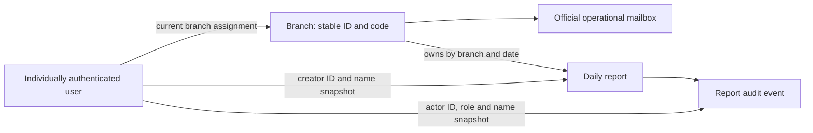

# Phase 5D account model assessment

Assessment date: 2026-09-23. Scope: read-only architecture and live development schema assessment; no implementation.

**Recommendation: keep individually attributable Manager and Head Office users, with official operational mailboxes attached to branches.** This is a small hybrid of person accounts and branch contact identity, already largely represented by `users.branch_id` and `branches.branch_email`. Do not recycle one user ID between different people or share a Head Office password.

Changing only a user's email to an official branch email is technically compatible with current login and branch authorization. It does not establish human accountability. A shared mailbox also cannot safely be the sole recovery factor for an account claimed to identify one person.

## 1. Preflight and evidence boundaries

`git status --short` returned no changes. `git log --oneline -8` returned:

```text
cbf65ef redesign manager and head office workspaces
0f6e8e9 harden authentication and production security
62371a6 remove legacy task workflows and clean repository
534f493 add report audit history timeline
419f92d add head office daily operations overview
9c42cb2 add audited report finalization and correction workflow
344a471 enforce branch isolation and report lifecycle
80082a0 harden application security and prepare phase 1 migration
```

The explicit request to create this assessment is treated as the sole exception to the general instruction not to modify files. This document is the only new file. No existing application or review file was edited.

Live schema evidence came from `information_schema` columns, indexes, foreign keys, checks and triggers in the configured development database: MySQL 8.0.44, InnoDB tables, REPEATABLE-READ isolation. Connections used `START TRANSACTION READ ONLY`, SELECT queries and rollback, then closed. No application server, setup utility, seed or migration was executed. Connection settings were loaded privately; their values were not printed. No stored password/hash column was selected. User/business data output was aggregate only; branch IDs, codes, names and public operational email addresses were inspected for the requested mapping assessment.

The inspections used several short read-only transactions rather than a single cross-session snapshot. Results describe this development database at assessment time, not an assurance about another deployment. No human identity, mailbox access or email deliverability was verified.

Primary code evidence:

- [Authentication controller](Bank-backend/controllers/auth.controller.js), [auth routes](Bank-backend/routes/auth.routes.js), [current-identity middleware](Bank-backend/middleware/auth.middleware.js), [role middleware](Bank-backend/middleware/role.middleware.js).
- [Report service](Bank-backend/services/business-report.service.js), [business controller](Bank-backend/controllers/business.controller.js), [business routes](Bank-backend/routes/business.routes.js).
- [Audit service](Bank-backend/services/business-audit.service.js), [audit UI](frontend/src/components/ReportAuditHistory.jsx), [report-detail UI](frontend/src/components/AdminBusinessReports.jsx).
- [Login](frontend/src/pages/Login.jsx), [API client](frontend/src/services/api.js), [session helper](frontend/src/utils/auth.js), [runtime app](Bank-backend/app.js), [dependencies](Bank-backend/package.json), [database utility boundaries](Bank-backend/DATABASE_UTILITIES.md).

`schema.json` is historical and was not used as the live schema authority.

## 2. Actual current schema

Notation: `NULL` means nullable. All integer columns below are signed unless otherwise stated; none below is unsigned. All string/text columns inspected use `utf8mb4_0900_ai_ci`. `CURRENT_TIMESTAMP` defaults are database generated. No CHECK constraints or triggers were returned for this database.

### users

| Column | Exact type | Null? | Default / extra |
| --- | --- | --- | --- |
| user_id | int | No | AUTO_INCREMENT |
| name | varchar(100) | Yes | NULL |
| email | varchar(100) | Yes | NULL |
| password | varchar(255) | Yes | NULL; bcrypt hash field in runtime |
| role | enum('EMPLOYEE','MANAGER','ADMIN','HEAD_OFFICE') | No | MANAGER |
| branch_id | int | Yes | NULL |
| branch_code | varchar(20) | Yes | NULL |
| branch_name | varchar(150) | Yes | NULL |
| phone | varchar(20) | Yes | NULL |
| joining_date | date | Yes | NULL |
| is_active | tinyint(1) | Yes | 1 |
| can_view_own_branch | tinyint(1) | Yes | 1 |
| can_view_all_branches | tinyint(1) | Yes | 0 |
| can_edit_reports | tinyint(1) | Yes | 0 |
| can_delete_reports | tinyint(1) | Yes | 0 |

There is **no users.created_at or users.updated_at**, no invitation state, no password-change timestamp and no session/token version. `joining_date` is not a credential lifecycle timestamp.

Indexes: `PRIMARY(user_id)`; UNIQUE `email(email)`; nonunique `branch_id(branch_id)`.

Foreign key: `users_ibfk_1`: `branch_id -> branches.branch_id`, ON UPDATE NO ACTION, ON DELETE NO ACTION.

Email is unique for non-NULL values using the stated case/accent-insensitive collation. Multiple NULL emails are possible; neither nonblank email nor a person name is enforced. Login accepts up to 254 characters, but stored email capacity is only 100. No branch/email-domain relationship is enforced.

A branch can have **zero, one or many users**, including many Managers. There is no unique constraint on branch assignment, no requirement that a branch have a Manager, and no database rule requiring a Manager to have a branch. Application checks supply the latter requirement for report operations. One user currently has at most one branch assignment.

### branches

| Column | Exact type | Null? | Default / extra |
| --- | --- | --- | --- |
| branch_id | int | No | AUTO_INCREMENT |
| branch_code | varchar(20) | No | No default |
| branch_name | varchar(150) | No | No default |
| branch_address | text | Yes | NULL |
| branch_city | varchar(100) | Yes | NULL |
| branch_district | varchar(100) | Yes | NULL |
| branch_state | varchar(100) | Yes | NULL |
| branch_pincode | varchar(10) | Yes | NULL |
| branch_email | varchar(100) | Yes | NULL |
| branch_phone | varchar(50) | Yes | NULL |
| branch_type | varchar(50) | Yes | Branch |
| is_active | tinyint(1) | Yes | 1 |
| created_at | timestamp | Yes | CURRENT_TIMESTAMP |
| updated_at | timestamp | Yes | CURRENT_TIMESTAMP; ON UPDATE CURRENT_TIMESTAMP |

Indexes: `PRIMARY(branch_id)`; UNIQUE `branch_code(branch_code)`. No other indexes or foreign keys. `branch_name` and `branch_email` are **not unique**. Branch contact email is already structurally separate from login email.

### daily_business_entries

| Column | Exact type | Null? | Default / extra |
| --- | --- | --- | --- |
| id | int | No | AUTO_INCREMENT |
| branch_id | int | No | No default |
| manager_id | int | No | No default |
| entry_date | date | No | No default |
| total_amount | decimal(15,2) | Yes | 0.00 |
| status | varchar(50) | Yes | draft |
| created_at | timestamp | Yes | CURRENT_TIMESTAMP |
| updated_at | timestamp | Yes | CURRENT_TIMESTAMP; ON UPDATE CURRENT_TIMESTAMP |
| branch_code | varchar(20) | Yes | NULL |
| branch_name | varchar(150) | Yes | NULL |
| manager_name | varchar(100) | Yes | NULL |
| total_entries | int | Yes | 0 |
| submitted_at | datetime | Yes | NULL |
| unlock_requested | tinyint(1) | No | 0 |
| unlock_reason | text | Yes | NULL |

Indexes: `PRIMARY(id)`; UNIQUE `unique_branch_entry_date(branch_id, entry_date)`; nonunique `phase1_entry_manager_fk(manager_id)`.

Foreign keys:

- `phase1_entry_branch_fk`: `branch_id -> branches.branch_id`, UPDATE RESTRICT, DELETE RESTRICT.
- `phase1_entry_manager_fk`: `manager_id -> users.user_id`, UPDATE RESTRICT, DELETE RESTRICT.

The unique key enforces one consolidated header per branch/date, not per Manager/date. No constraint ties the creator's current branch assignment to the report's branch; that would be inappropriate after a transfer.

### daily_business_items

| Column | Exact type | Null? | Default / extra |
| --- | --- | --- | --- |
| id | int | No | AUTO_INCREMENT |
| entry_id | int | No | No default |
| sr_no | int | No | No default |
| account_type | varchar(100) | No | No default |
| status | varchar(50) | No | No default |
| amount | decimal(15,2) | Yes | 0.00 |
| remark | text | Yes | NULL |

Indexes: `PRIMARY(id)`; nonunique `entry_id(entry_id)`. No unique serial-number index. FK `daily_business_items_ibfk_1`: `entry_id -> daily_business_entries.id`, UPDATE NO ACTION, DELETE CASCADE. There is no user/branch identity on items; it comes from the header.

### daily_business_audit_logs

| Column | Exact type | Null? | Default / extra |
| --- | --- | --- | --- |
| id | int | No | AUTO_INCREMENT |
| entry_id | int | No | No default |
| branch_id | int | No | No default |
| action | varchar(50) | No | No default |
| actor_id | int | No | No default |
| actor_role | varchar(50) | No | No default |
| actor_name | varchar(100) | No | No default |
| previous_state | json | Yes | NULL |
| new_state | json | Yes | NULL |
| reason | text | Yes | NULL |
| ip_address | varchar(45) | Yes | NULL |
| user_agent | text | Yes | NULL |
| created_at | timestamp | Yes | CURRENT_TIMESTAMP |

Indexes: `PRIMARY(id)`; nonunique `actor_id(actor_id)`, `branch_id(branch_id)`, `phase1_audit_entry_fk(entry_id)`. No unique action/milestone index; correction and resubmission can legitimately produce more than one SUBMIT over a report's lifetime.

Foreign keys:

- `daily_business_audit_logs_ibfk_2`: `branch_id -> branches.branch_id`, UPDATE NO ACTION, DELETE NO ACTION.
- `daily_business_audit_logs_ibfk_3`: `actor_id -> users.user_id`, UPDATE NO ACTION, DELETE NO ACTION.
- `phase1_audit_entry_fk`: `entry_id -> daily_business_entries.id`, UPDATE RESTRICT, DELETE RESTRICT.

Audit branch equality with its report is enforced by the service, not a composite database FK. Runtime exposes no audit rewrite endpoint; this is not database-level tamper-proof storage against a privileged database writer.

### Roles, permissions and legacy tables

There is no separate roles, permissions, memberships, sessions, invitations or recovery-token table. Runtime authorization uses `users.role`, active state and branch, not the four legacy permission flags. Login includes `can_view_all_branches` as a compatibility JWT claim, but the authorization middleware does not trust it.

The other live tables are `tasks`, `task_updates`, `time_logs`; they are legacy, with no mounted task API. Relevant retained user dependencies:

| Constraint | Link | Update / delete |
| --- | --- | --- |
| tasks_ibfk_1 | tasks.assigned_by -> users.user_id | NO ACTION / NO ACTION |
| tasks_ibfk_2 | tasks.assigned_to -> users.user_id | NO ACTION / NO ACTION |
| task_updates_ibfk_1 | task_updates.task_id -> tasks.task_id | NO ACTION / NO ACTION |
| time_logs_ibfk_1 | time_logs.task_id -> tasks.task_id | NO ACTION / NO ACTION |
| time_logs_ibfk_2 | time_logs.user_id -> users.user_id | NO ACTION / NO ACTION |

These add reasons to disable retained users rather than delete them. `tasks.branch_id` has no branch FK. No legacy business/task rows were printed.

## 3. Current account model and authentication

The application is **C: a mixture**, with a user row representing an authenticated principal but no explicit distinction between person and operational account. `name`, `phone`, `joining_date` and creator/actor references suggest person-oriented origins. Branch assignment and generic Manager email patterns support operational usage. There is no verified person identifier, account-kind field or record of who held a shared account at a particular time. Names alone cannot prove that current development accounts represent distinct real people.

Actual request path:

1. Login form posts `{ email, password }` to `/api/auth/login`. It accepts an email address despite the visible label "Username".
2. Auth route applies its IP limiter (30 requests per five minutes, including successes), a 16 KB JSON limit, then the controller.
3. Controller checks nonempty string inputs, trims email, and queries `users` by email with a left join to `branches`. There is no domain restriction, mailbox-ownership verification or personal-email assumption.
4. `bcrypt.compare` checks `users.password`; absent users/passwords use a synthetic dummy encoding. Only a matching password and `Number(is_active) === 1` succeed. A NULL password is not an implemented invitation flow.
5. HS256 JWT expires after 10 hours. It contains user ID, role, branch ID, branch code/name and a compatibility permission flag, plus standard signing timestamps. It contains neither email nor name. Response user metadata includes name/email for presentation.
6. Frontend stores token, role and user in localStorage; MANAGER routes to `/manager`, HEAD_OFFICE/ADMIN to `/admin`. EMPLOYEE has no supported reporting workspace. Axios sends `Authorization: Bearer ...`.
7. Protected middleware verifies signature, expiry, algorithm and user ID, then selects the **current** `user_id, role, branch_id, is_active` from the database. Missing/inactive/unsupported-role users are rejected. Identity lookup failure returns 503.
8. `req.user` is rebuilt as `{ user_id, role, branch_id }`. Token role/branch claims and client-supplied branch metadata do not authorize requests. Routes and report service enforce access.

Changing only email, retaining user ID/branch/role/name, needs account-data changes, **not an authentication redesign**. The new value must fit the field and unique constraint. Existing tokens remain usable, and cached frontend email may remain old until a new login. A mailbox change is therefore not credential/session revocation.

Names are presentation and audit snapshots, not authorization keys. Manager operations require a valid branch; login itself does not require it. Head Office access is role-based and does not need branch assignment. User activity is checked, but neither login nor Manager write metadata lookup currently rejects an inactive branch. Daily overview filters active branches. Do not rely on disabling a branch alone to disable its users.

## 4. Report ownership and manager handover

Operational ownership is **branch_id**; **manager_id records the original creator**. Both are stored and foreign-key protected, but they have different meanings.

On creation, `createReportService.create` derives branch from authenticated `req.user`, rejects conflicting client branch IDs, reads branch code/name and creator name from the database, and inserts the header with `manager_id = req.user.user_id` and a `manager_name` snapshot. Items belong to the header. Optional immediate submission is a DRAFT -> SUBMITTED transition in the same transaction with its audit milestone.

Read, history, draft updates, deletion, submission and correction requests scope Managers by the **current authenticated branch**, not by matching `manager_id`. Updating a draft does not replace creator ID/name. State rules still apply. A successor Manager in Pune can read Pune history and edit an eligible Pune draft created by a predecessor; cannot edit a final-locked report. The branch/date unique key prevents a successor creating a second header for that date.

Therefore, if A creates Pune's report and B later takes over:

- The report remains Pune's through `entry.branch_id`, regardless of A's subsequent transfer or deactivation.
- With a distinct B user, the report retains A as creator; B's later audited actions record B.
- Disabling A does not alter report/audit rows. Deleting A is blocked where restrictive references exist; do not bypass them.
- Updating A's branch moves A's future authorization, not existing reports. A then loses old-branch access and gains new-branch access even using an already-issued JWT, because authorization reloads the user.
- Reusing A's row for B leaves the same creator/actor ID identifying two people across time. Data stays referentially valid but its human meaning becomes unreliable.

**Historical display inconsistency found:** `business.controller.getBranchDetails` selects `e.*` and then `u.name AS manager_name` from the CURRENT creator user. It returns that joined name to Head Office's report detail, overriding the stored name snapshot. Renaming a recycled user from A to B can make an old report display B as "Manager". By contrast, the branch summary uses `e.manager_name`, and audit history uses stored audit names. This requires a narrow historical-display correction before any account reassignment/renaming rollout, not a report ownership migration.

Creator does not mean last editor or submitter. Only milestone actions are currently audited; draft edits are not a full change history. Do not infer the submitter from the report's Manager label.

## 5. Audit attribution

`insertMilestone` runs on the report mutation's transaction connection. It checks the allowed action, role and transition; reads the name for the authenticated user ID; then stores:

- Report `entry_id` and the **report's** `branch_id`.
- `actor_id` from verified identity; `actor_role` as observed for the action; `actor_name` read at event creation. A NULL name falls back to `User #<id>`; an empty name is not converted by that fallback.
- Action and previous/new JSON states. SUBMIT: DRAFT -> SUBMITTED. FINAL_LOCK: SUBMITTED -> FINAL_LOCKED.
- Correction actions retain pending flags; the prior pending state's JSON may contain `unlock_reason`. Request/decision reason goes into `reason`.
- Database-default `created_at`. No actor email field exists. IP/user agent remain NULL in the current writer. SUBMIT/FINAL_LOCK reason is omitted and defaults NULL.

Audit reads select persisted actor name/role directly from `daily_business_audit_logs`, ordered by `created_at, id`; **they do not join users for display**. The serializer limits fields and strips unapproved JSON state properties. Actor ID remains in storage but is not currently returned in the public history DTO. React displays name/role as text.

Shared Pune-account scenario:

| Naming practice | Old events after B takes over | New B-era events | What can actually be established |
| --- | --- | --- | --- |
| Name always "Pune Branch" | Pune Branch | Pune Branch | Operational account only; no authenticated person distinction |
| Name A, later changed to B | A snapshot stays A | B snapshot | Same actor ID; names differ, but no independently authenticated human or recorded handover proves who used it |
| Name remains A after B takes over | A | A | New events misleadingly name A |

Changing email alone does not rewrite old audit snapshots and is invisible in this audit model. Even individual accounts provide account attribution rather than cryptographic proof of a physical person; controlled provisioning and non-shared recovery are required. Existing historical events must not be relabeled as a newly asserted human without independent evidence.

## 6. Existing aggregate user and branch state

| Role | Users | Active | With branch_id | Missing email/name |
| --- | ---: | ---: | ---: | --- |
| MANAGER | 37 | 37 | 37 | 0 / 0 |
| HEAD_OFFICE | 1 | 1 | 1 | 0 / 0 |
| ADMIN | 0 | 0 | 0 | Not applicable |
| EMPLOYEE | 20 | 0 | 20 | 0 / 0 |
| Total | 58 | 38 | 58 | 0 / 0 |

- There are 38 branches, all active: one Administrative Office, one Main Branch, 36 other branches.
- Managers occupy 37 distinct branches. No branch has multiple Managers or multiple active Managers today; this is a data property, not a uniqueness constraint.
- Exactly one active location has no Manager: the Administrative Office. Its active HEAD_OFFICE user is assigned there. All 37 non-office locations have an active Manager. No branch lacks all users.
- Manager assignments have no NULL/missing/inactive branch and no detected stale duplicate branch code/name.
- All user emails use the official domain. All Manager emails begin with `manager`; none equals a stored branch contact mailbox. Domain membership and naming patterns do not establish mailbox existence or personal ownership.
- Branch contact emails are populated for all 38 locations but have only **37 distinct values**. No stored branch contact email currently matches a login email. No user currently occupies the proposed `aucb_ho@akolaurban.bank.in` login address.
- Aggregate integrity: eight report headers; zero missing branches/creators and zero creators currently assigned to a different branch. One audit event; zero missing report/actor references or audit/report branch mismatches. These are not a re-verification of a previously tested SUBMIT -> FINAL_LOCK sequence.

Head Office's daily overview includes every active branch record, including the Administrative Office, so it currently counts 38 reporting locations despite only 37 Managers. Whether the office should submit a report is a separate business decision. Do not provision an extra Manager, change denominators or assign reporting duties merely to match the directory count.

## 7. Person, branch and hybrid comparison

| Concern | A: individual person account | B: persistent shared branch account | Recommended small hybrid |
| --- | --- | --- | --- |
| Schema fit | Already supported | Already supported as an untyped user row | Existing branch contact plus distinct users; no new ownership model |
| Branch isolation | Current user.branch_id | Same mechanism | Same mechanism |
| Report ownership | Branch retained; original creator retained | Branch retained; creator becomes operational principal | Branch retained; human creator/actors retained |
| Audit accountability | Distinct user IDs and name snapshots, if credentials/recovery are controlled | Account attribution only; reuse obscures people | Person actors plus stable branch contact |
| Manager replacement | Disable A, create distinct B; never recycle IDs | Same ID/password handover | Same as A; branch mailbox stays stable |
| Manager transfer | Reassign the same person with controlled session revocation | Person stops using one shared login and receives another | Same as A |
| Password lifecycle | Separate invitation/reset per person | Reset plus mailbox access removal and session invalidation at each handover | Individual recovery; branch mailbox for operational contact |
| Operational effort | More onboarding/offboarding records | Fewer accounts, harder investigation and custody control | Small additional personnel process; no enterprise IAM required |
| Security tradeoff | Departure can revoke one person | Cannot distinguish/revoke one sharer without affecting all | Least ambiguity without changing report workflow |
| Required app change | Credential lifecycle missing | Email-only conversion is small; safe human attribution is not solved | Small lifecycle addition and historical display fix |

Model A requires a distinct, controlled login identifier. Because `users.email` is unique, successive retained person accounts cannot both use exactly the same branch mailbox as their login. Do not evade this by renaming old users to fabricated addresses or deleting their history.

Model B can be chosen explicitly as account-level accountability, but it does not meet the stated aim of individually attributable banking actions. A typed "operator name" field, a current-custodian label, or a handover spreadsheet does not authenticate the operator. Adding those fields alone is insufficient.

## 8. Hybrid model and Head Office

The recommended structure is already mostly present:



Use `branches.branch_email` for the operational address, and `users.email` for a uniquely controlled organizational login/recovery address belonging to the authorized person. A Manager change updates authorized users, not the branch's identity. The current one-person-to-one-current-branch model is sufficient. A person table, many-to-many branch membership, delegation engine or enterprise directory is unnecessary for this phase.

**Important dependency:** the user has confirmed branch mailboxes, not individual organizational mailboxes. If individual addresses do not exist, that must be resolved before claiming this model is deployable. Do not silently treat aliases forwarding to the same shared inbox as independent recovery. A future employee-ID login with a separately verified recovery channel is possible but adds auth/UI schema work; it is not required in the recommended email-based Phase 5D. Alternatively, use administrator-assisted recovery with independently verified identity rather than a shared-inbox self-service reset. There is no purely cosmetic way around this trust boundary.

`aucb_ho@akolaurban.bank.in` **can technically be a HEAD_OFFICE login** today: email lookup is generic, role grants central authority and branch is not required. Current assignment to the Administrative Office does not constrain Head Office's report access. The address does not automatically grant Head Office rights; role still must be explicitly provisioned.

Recommended meaning: the official Head Office operational/contact mailbox. Give each authorized Head Office person a separate HEAD_OFFICE user and recovery channel. Multiple people sharing the one account would make all final-lock and correction decisions attributable only to that account. Its compromise exposes authority across all branches. ADMIN remains a transitional central reader, with no final-lock/correction-decision or audit-history authority; do not promote it implicitly.

## 9. Official email mapping considerations

The [official AUCB network page](https://www.akolaurban.bank.in/aucb-network) has a 38-location directory and another differently ordered 37-row directory. Some spellings/mailboxes differ between the two, notably Sindhi Camp/Adarsh Colony, Murtizapur and Jaisthambh. Neither directory serial numbers nor a row's position should be used as database IDs. This comparison identifies candidates, not verified mailbox custody.

The five examples supplied in the request map by current database names/codes as follows:

| Location | Existing ID / code | Proposed official mailbox | Current branch contact result |
| --- | --- | --- | --- |
| Administrative Office, Akola | 1 / AUCB001 | aucb_ho@akolaurban.bank.in | **Mismatch:** currently stores aucb_main@akolaurban.bank.in |
| Main Branch, Akola | 2 / AUCB002 | aucb_main@akolaurban.bank.in | Matches |
| Ramdaspeth Branch, Akola | 3 / AUCB003 | aucb_ramdaspeth@akolaurban.bank.in | Matches |
| Pune Branch | 37 / AUCB037 | aucb_pune@akolaurban.bank.in | Matches |
| Wani Branch | 38 / AUCB038 | aucb_wani@akolaurban.bank.in | Matches |

Comparison of all current branch contact values with the first directory found 37 matching named candidates and the office mismatch. Local names sometimes add/remove a city suffix. The old/new Aurangabad/CH.Sambhaji Nagar and Nasik/Nashik naming variants also need explicit handling. These observations are based on the live branch catalogue and the [official directory](https://www.akolaurban.bank.in/aucb-network), not ordinal matching.

Future mapping must record branch code, existing ID, reviewed name/location, chosen mailbox, authoritative source and reviewer. Local AUCB codes are unique internally; this inspection did not establish them as official external identifiers. Confirm aliases, destination mailbox, current authorized readers and delivery before any setup email. Reject duplicate/colliding login addresses; do not automatically copy `branches.branch_email` into `users.email`.

The office mismatch would send an office-directed setup link to Main Branch if the current contact column were blindly trusted. No value was corrected here. A reviewed future data correction is separate from a schema migration or an account conversion.

## 10. Password setup/reset readiness

| Capability | Current state |
| --- | --- |
| Password hash storage | Nullable users.password varchar(255); bcrypt comparison |
| First-time setup / invitation state | Absent |
| Reset token storage, purpose, expiry, consumption | Absent |
| password_changed_at / session version | Absent |
| Account disable | users.is_active, checked at login and every protected request |
| Auth endpoints | POST /api/auth/login only |
| Provisioning endpoint / supported tool | Absent; historical seed tools removed/restricted |
| Email sending | No mail transport, template service or sending dependency in runtime |
| Frontend lifecycle screens | No setup, forgot-password or reset screen |

Existing dependencies include bcryptjs, jsonwebtoken, mysql2, express-rate-limit and dotenv. They help with hashing, transactions, rate limiting and configuration, but do not supply the missing workflow. Node's built-in [crypto API](https://nodejs.org/api/crypto.html) provides random bytes and hashing without installing a token library. Access JWTs should not be reused as password-reset credentials. Email transport/provider configuration is a future addition, not present readiness.

Desired future invitation: authorized operator verifies person/role/branch/recovery address -> creates inactive invited user with NULL password -> issues purpose-bound setup link -> recipient chooses password -> transaction consumes link, sets hash and activates invited account -> user performs normal login.

Desired future reset: request for known login -> generic response -> eligible account gets reset link at its previously verified recovery destination -> transaction consumes link, changes password and revokes prior sessions -> normal login. A public request must not activate a disabled/departed user or change role/branch/email.

## 11. Security analysis tied to current architecture

Use random, single-use, expiring recovery tokens, consistent public responses, request throttling, trusted HTTPS reset URLs and no automatic login after reset. Notify the account holder of a completed reset without including the password. These are consistent with [OWASP recovery guidance](https://cheatsheetseries.owasp.org/cheatsheets/Forgot_Password_Cheat_Sheet.html).

The following concrete choices are proposed for this application, not claims about existing behavior:

| Question | Assessment / proposed decision |
| --- | --- |
| Raw or hashed token storage? | Generate 32 random bytes; email the encoded bearer token, retain only its SHA-256 digest. Never put the raw token/link in database logs, application logs or audit metadata. High-entropy token digests have different requirements from low-entropy user passwords. |
| Expiry? | Proposed 30-minute reset and 24-hour invitation lifetimes, configurable with bounds; use UTC server/database comparisons and reject at or after expiry. These are design choices, not regulatory constants. |
| Single use? | Yes. Consume and change password atomically under a user/token lock. Two racing submissions must yield one success. Reissue invalidates prior outstanding tokens; reset success invalidates all outstanding credential tokens for that user. |
| Existing JWT after reset today? | Still valid until its original 10-hour expiry while the user remains active. Middleware never checks password age or token version. Changing the hash or email alone does not revoke it. |
| Current revocation capability? | Disabling a user blocks their next protected request; secret rotation invalidates all users' signed tokens. No per-user session generation or per-token logout revocation exists. Frontend logout only clears localStorage. Re-enabling a user can revive an unexpired old JWT. |
| Smallest suitable revocation addition? | Add users.auth_version, include it in new JWTs and compare it in the existing current-identity lookup. Increment on password set/reset, account disable/reactivation, branch/role transfer and recovery-address change. Reject versionless old tokens at rollout, requiring sign-in again. No refresh-token platform is needed. |
| Timestamp alternative? | password_changed_at plus JWT iat checking can work with careful clock/precision handling. A version counter is simpler for repeated same-second changes and non-password events. Keep password_changed_at for operations; do not build two independent revocation systems. |
| Request race? | Revocation affects subsequent authentication checks, not work already authorized/in flight. Serialize credential transitions; ensure login cannot mint a new-version token after comparing an old password. Do not claim middleware alone cancels an already-running report transaction. |
| Mailbox compromise? | The attacker can receive setup/reset credentials for accounts recovered through it. Suspend affected access, revoke sessions and outstanding links, recover mailbox custody, then re-establish identity through an independent operator process. Resetting only the app password cannot repair compromised recovery. |
| Shared branch password? | No individual revocation, ambiguous actor identity, easy continued access after handover, and all readers of shared recovery mail can regain control. Renaming the account or recording an operator-entered name does not fix authentication. |
| Shared Head Office password? | Same ambiguity with cross-branch finalization/correction powers. Separate human accounts are especially important. |

Session invalidation on recovery and careful browser token handling are supported by [OWASP session guidance](https://cheatsheetseries.owasp.org/cheatsheets/Session_Management_Cheat_Sheet.html). The existing localStorage bearer design remains susceptible to token theft through same-origin script compromise; switching all auth to cookies/SSO is outside this minimal phase, not something a reset endpoint solves.

Proposed credential validation should reject common/compromised passwords, allow passphrases and avoid arbitrary composition rules. Retaining bcrypt requires an explicit UTF-8 72-byte limit to avoid silent truncation; do not confuse that with the current 1,024-character login request cap. Set a documented password policy and measured hashing cost for new credentials, preserving verification of existing hashes. See [OWASP authentication guidance](https://cheatsheetseries.owasp.org/cheatsheets/Authentication_Cheat_Sheet.html) and [password storage guidance](https://cheatsheetseries.owasp.org/cheatsheets/Password_Storage_Cheat_Sheet.html). Policy and hash parameters must be tested during implementation, not inferred from unseen live hashes.

## 12. Must / should / optional

These are engineering recommendations for the proposed deployment, not a legal compliance certification.

| Priority | Scope |
| --- | --- |
| MUST before deployment of account lifecycle | Verified person-to-account assignment; individually controlled recovery or independently verified assisted recovery; distinct HO users; reviewed branch/mail mapping; fix office contact mismatch before using it; safe provisioning with no default passwords; purpose-bound expiring single-use tokens; atomic password change and session revocation; disabled-account protection; input/abuse controls; no secret logging; operational offboarding process; regression tests preserving branch isolation and audit meaning. |
| MUST preserve | Existing report IDs, branch ownership, creator IDs/name snapshots and audit events; restrictive FKs; server-side current role/branch authority; one header per branch/date; final-lock/correction rules; Manager/HO UI and Login appearance. |
| SHOULD | Mailbox MFA and access reviews; application MFA prioritizing HO; security-event retention/monitoring; tested mail delivery/failure handling; audited transfers/recovery-destination changes; clearer creator/actor labels; version-backed authenticated logout; periodic user/branch coverage checks. If deploying multiple API instances, coordinate rate limits across them. |
| OPTIONAL / future | Corporate SSO, phishing-resistant MFA integration, richer staff identity/assignment history, multiple branch memberships, temporary delegated authority, device/session inventory, immutable external audit storage, enterprise IAM. These are not prerequisites for the narrow implementation proposed here. |

## 13. Exact proposed smallest safe Phase 5D scope

### Decision and rollout prerequisites

Keep person accounts and adopt the small hybrid described above. Treat `aucb_ho` as office contact, not a shared high-authority principal. Do not mass-convert existing Manager logins to branch addresses. Before provisioning, obtain a reviewed list of authorized people and independently controlled recovery destinations. Existing generic development emails/names must not be assumed to be verified production identities.

If only shared mailboxes are available, defer self-service production rollout until an independent recovery path is approved. Implementing shared-account recovery and calling it human attribution is not an acceptable shortcut. No forced conversion or user-data cleanup is part of this assessment.

### Proposed schema changes (design only; no migration written)

1. Add `users.account_state ENUM('INVITED','ACTIVE','DISABLED') NOT NULL`, with reviewed migration classification. Keep `is_active` for compatibility and enforce consistency in lifecycle operations. Existing active valid accounts map to ACTIVE, inactive accounts to DISABLED; do not automatically label inactive legacy users as invited. New invites use INVITED, `is_active=0`, `password=NULL`.
2. Add `users.auth_version INT UNSIGNED NOT NULL DEFAULT 0` and nullable `users.password_changed_at DATETIME(6)` using UTC. Add users `created_at`/`updated_at` only if desired later; they are not needed for the minimal flow. Do not invent past password-change dates.
3. Add `account_action_tokens`: `id BIGINT UNSIGNED` primary auto-increment; `user_id INT NOT NULL` FK to users with RESTRICT; `purpose ENUM('SETUP','RESET') NOT NULL`; `token_hash BINARY(32) NOT NULL UNIQUE`; `auth_version INT UNSIGNED NOT NULL`; `created_at DATETIME(6) NOT NULL`; `expires_at DATETIME(6) NOT NULL`; nullable `used_at` and `revoked_at DATETIME(6)`. Index `(user_id,purpose)` and `expires_at`. Lock the user to serialize issuance/consumption and require the stored version to match. Token rows hold no raw password, raw bearer token or request body.
4. Add a small separate `account_security_events` table because report audit requires a report ID and cannot represent provisioning/reset. Proposed columns: auto-increment `id BIGINT UNSIGNED`, `subject_user_id INT NOT NULL` FK RESTRICT, nullable `actor_user_id INT` FK RESTRICT, `actor_source VARCHAR(40) NOT NULL`, nullable verified operator reference `VARCHAR(100)`, `action VARCHAR(50) NOT NULL`, `created_at DATETIME(6) NOT NULL`; indexes `(subject_user_id,created_at)` and `actor_user_id`. Use allowlisted actions for provisioning, invite issuance, setup/reset completion, disable and assignment/identity changes. Recovery completion identifies the subject and token flow, not a falsely authenticated administrator. CLI operator reference comes from the controlled operator process, not public input. No free-form request dump or credential fields.

No report/item/branch-ownership schema change, no person table, no actor-email column, no user-branch unique constraint and no new permission system are required. Existing branch_email/email lengths fit the listed addresses. Keep current uniqueness and require nonblank verified unique email/name through the provisioning service. Widening email fields can be separate if actual accepted addresses exceed 100 characters. Merely using branch emails would need none of the above DDL; these changes support secure lifecycle, not email substitution itself.

### Backend surface

| Proposed entry point | Exact responsibility |
| --- | --- |
| Restricted operator CLI: provision/invite/reissue/disable/transfer | Controlled deployment operator creates a distinct person user or updates authorized assignment, verifies role/branch/destination, records operator action, and invalidates relevant tokens/sessions. Dry-run first; explicit apply; no default passwords; no wholesale user replacement. No new public registration endpoint or broad account-admin UI. |
| POST /api/auth/forgot-password | Accept email only; generic response; eligible ACTIVE supported account only; per-IP and per-account limits; token sent only to the stored verified individual address. No account activation, role change or requester-selected destination. |
| POST /api/auth/setup-password | Accept setup token and new/confirmed password; require correct purpose, unexpired/unconsumed token, matching version and INVITED state; atomically establish credentials, activate, consume/revoke tokens and audit. |
| POST /api/auth/reset-password | Accept reset token and new/confirmed password; require ACTIVE state and all token checks; atomically change hash, increment version, consume/revoke tokens and audit. Never reactivate DISABLED users. |
| Existing POST /api/auth/login | Add state/version handling and race-safe credential/version observation; retain email/password contract, roles, bcrypt verification and generic failure behavior. |
| Existing verifyToken middleware | Extend existing DB lookup with state/version checks; continue deriving branch and role from current DB identity. |

No public invite-creation/resend endpoint is required. Reissue goes through the controlled operator CLI. No GET endpoint should consume a token; link scanners must not establish credentials. A single shared internal token service may back both completion endpoints, with explicit purpose checks.

A future mail adapter needs trusted HTTPS application origin, configured sender/transport credentials, templates, timeout/failure behavior and a fake transport for tests. On delivery failure retain a safe retry/reissue route without activating the user or printing the token. Production outbound email remains a separate, explicitly authorized rollout action.

### Frontend surface

Add narrowly scoped `/setup-password`, `/forgot-password` and `/reset-password` screens. Setup/reset support password confirmation, expiry/invalid-link feedback and return to normal sign-in. Add only a small Forgot password action to existing Login when that implementation is authorized; preserve its current visual design. No new Manager/HO redesign or public registration page.

Use a separate unauthenticated client for recovery so generic 401 handling cannot unexpectedly redirect a recovery page or attach an existing bearer token. Keep raw setup/reset tokens out of localStorage, telemetry and logged URLs; serve recovery pages without third-party scripts and with no-referrer/no-store protections. The link format and proxy/static-host logging must be reviewed together.

### Audit and historical display changes

- Preserve all existing report audit rows and their meaning. Do not backfill a claimed human actor from current names or branch mailbox ownership.
- Fix Head Office report detail to use stored `e.manager_name` as creator snapshot and label it accordingly; show unavailable history honestly rather than silently substituting the current user name.
- Retain actor ID/name/role snapshots. Include actor ID in the authorized audit DTO/display only as needed to disambiguate identical human names; there is no need for actor email or a new report-audit FK.
- Keep account lifecycle events in the separate minimal security-event table, not fake report events. Ensure credential state changes and their completion events commit together. Avoid auditing password/token material.

### Behavior that must remain unchanged

Branch/date uniqueness; branch isolation from verified identity; original report creator references; exact server-side totals and India business dates; DRAFT -> SUBMITTED -> FINAL_LOCKED workflow; pending-correction decision rules and atomic milestones; role-specific central authority; transitional ADMIN read access only; EMPLOYEE reporting exclusion; report history/audit authorization; Phase 5C authenticated design and Phase 5B Login appearance.

Intentional auth changes are limited to setup/reset/state/version behavior and session invalidation. Existing tokens without versions should be invalidated at an announced deployment boundary rather than accepted indefinitely. Authentication remains mandatory and server-authoritative.

### Required implementation verification later

Run existing backend regression suite, frontend helpers/lint/build and isolated browser checks, plus focused lifecycle tests: unknown/inactive enumeration behavior; wrong-purpose/expired/reused/revoked tokens; concurrent consumption and login/reset race; invite reissue; disabled-user reset refusal; email failure; absence of credential leakage; old JWT rejection after reset/transfer/reactivation; multiple distinct users in one branch; manager handover retaining original creator/audit snapshots; same-name actor distinction; duplicate mailbox mapping; Head Office authority boundaries. Use synthetic mail and isolated database fixtures. Do not run tests against live business records.

## 14. Risks and unresolved decisions

- Individual mailbox/recovery ownership is not yet established. This is the main dependency for the recommended self-service flow, not a reason to create an IAM platform.
- Administrative Office has the wrong branch contact email and no Manager. Contact correction and whether it is a reporting unit are separate reviewed decisions.
- The public directory itself has conflicting aliases/order; scraping cannot authorize recipients.
- Recycled user IDs, renamed users and current-name report joins can misstate historical responsibility even while branch totals remain correct.
- Current deactivation revokes access only while inactive; reactivation and transfers need version invalidation. Password resets alone are insufficient today.
- Current audit is a milestone history, not a complete draft-edit ledger or proof of the person at the keyboard.
- Existing runtime privileges do not define an account administrator. The proposed operator CLI needs controlled operator access and attribution; do not infer account-provisioning authority from HEAD_OFFICE reporting authority.
- Email delivery, provider choice, production secrets, mailbox MFA/custody, server timezone and deployment topology were not operationally tested here.

## 15. Explicit non-actions and stopping point

Only this requested assessment document was created. No application code changed. No live user, password, branch, report, item or audit row was changed. No migration, setup, seed, mutation statement, test workflow, email delivery, dependency installation, commit or push was performed. Existing tests were not rerun because this task changes no executable code; prior passing counts are not presented as new verification. Work stops at this assessment.

IMPLEMENTATION PERFORMED: NO
DATABASE MUTATED: NO
SCHEMA CHANGED: NO
USERS MODIFIED: NO
PASSWORDS/HASHES/SECRETS PRINTED: NO
EMAIL SENT: NO
DEPENDENCIES INSTALLED: NO
COMMITTED: NO
PUSHED: NO
